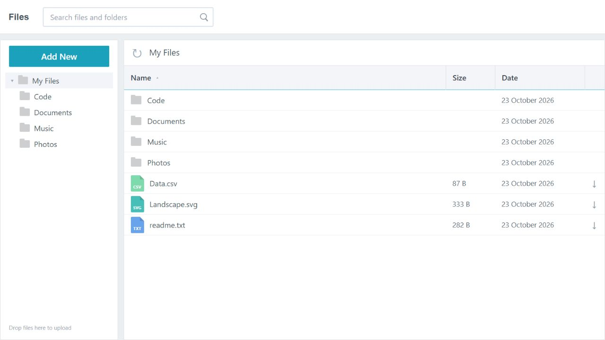
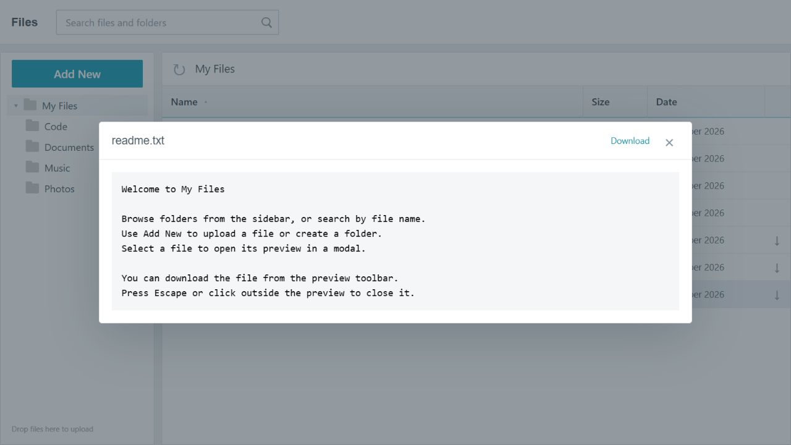
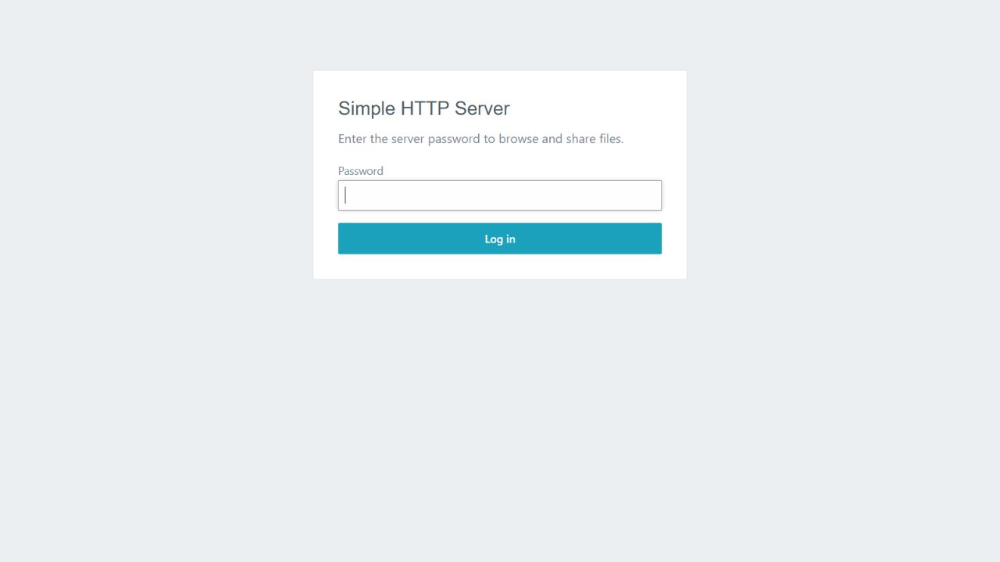

# Simple HTTP Server

A small Rust server for browsing, sharing, and uploading files from the current
working directory. The browser UI uses SpineJS v0.0.1 and is embedded in the
executable, including its styles and framework runtime.

This project is intended for quick file sharing, not production hosting.

## Install and run

After version 0.2.0 is published to crates.io, install it with Rust and Cargo:

```sh
cargo install jack-http-server --locked
```

The package is named `jack-http-server`; the installed command is `http-server`.
Ensure Cargo's binary directory (`~/.cargo/bin` on Unix, `%USERPROFILE%\.cargo\bin`
on Windows) is on your `PATH`.

Run it from any directory you want to share:

```sh
cd path/to/files
http-server
```

Open `http://localhost:8888/`. The server shares the directory from which you
launch it. Choose a different HTTP port with `http-server --port 8000`.
Run `http-server --help` for options and press Ctrl+C to stop.

The executable embeds all browser assets. No Node.js runtime, repository
checkout, or frontend build is required to run it.

To install the current checkout before publication:

```sh
cargo install --path . --locked
```

## Run from source

```sh
cargo run
```

Open `http://localhost:8888/`. To choose a different HTTP port:

```sh
cargo run -- --port 8000
```

Build an optimized executable with `cargo build --release`. The binary is
`target/release/http-server.exe` on Windows and `target/release/http-server` on
Unix systems. The default build includes the command-line server. The optional
GUI can be built separately with `cargo build -p gui` and launches `http-server`
from your `PATH`.

## File browser

The UI provides a folder sidebar, filename search, sorting by name, size, or date,
folder creation, uploads (including drag and drop), and downloads. Text, image,
PDF, and video previews open in a modal with a download link. Close a preview with
Escape, the close button, or a click on the backdrop. Videos use range requests.





The screenshots use sample files. The server shows the contents of the directory
from which you launch it.

## Authentication and HTTPS

Generate a local certificate and key with OpenSSL:

```sh
openssl req -x509 -newkey rsa:4096 -nodes -keyout key.pem -out cert.pem -days 365 -subj '/CN=localhost'
```

Start the server with a password and the certificate paths:

```sh
http-server --authenticate --password your-password --pem-file key.pem --cert-file cert.pem
```

Authenticated mode listens on HTTPS port `8443`; `--port` applies to plain HTTP.
Login uses an encrypted, HTTP-only cookie session. Passwords are not stored in
Spine's persistent browser state. OpenSSL is needed only to generate the
certificate; the server uses Rustls at runtime.



## Development

```sh
node --test backend/tests/frontend.test.cjs
cargo test --locked
cargo build --locked
```

Node.js is needed only for the frontend tests. The Actix integration tests use
local temporary fixtures and do not require a running server.

For a separate loopback preview host:

```sh
cargo run --example spine_preview -- 8889
```

Open `http://127.0.0.1:8889/`. This example uses the same embedded UI and routes
with authentication disabled. Rebuild and restart after frontend changes because
Rust embeds the assets at compile time.

| Location | Purpose |
| --- | --- |
| `Cargo.toml` | Publishable CLI and library package, with the GUI workspace member |
| `backend/` | HTTP handlers, authentication, embedded frontend, and tests |
| `backend/src/www/spine-ui/` | Application components, styles, and API adapter |
| `backend/src/www/vendor/spine/` | Pinned framework-only SpineJS release assets |
| `cli/` | Command-line server launcher |
| `gui/` | Native tray application that launches the CLI |
| `screenshots/` | Current browser, login, and modal screenshots |

## Release

The crate name `http-server` on crates.io belongs to another project. Publish
this project as `jack-http-server`; its executable is still named `http-server`.

Before publishing, run:

```sh
cargo fmt --all --check
node --test backend/tests/frontend.test.cjs
cargo test --locked
cargo publish --dry-run --locked
```

For a local dry run with uncommitted release changes, add `--allow-dirty` to
`cargo publish --dry-run`. Inspect the included files with `cargo package --list`.
The package includes the server sources and embedded assets and excludes the GUI,
screenshots, local TLS credentials, and build output.

To publish version 0.2.0 through GitHub Actions:

1. Configure the repository Actions secret `CARGO_REGISTRY_TOKEN` with a crates.io
   API token permitted to publish `jack-http-server` (including its first version).
2. Commit and push the release changes. The tag must match `Cargo.toml`'s version.
3. Create and push the release tag:

   ```sh
   git tag v0.2.0
   git push origin v0.2.0
   ```

The release workflow checks the version and tests, publishes the crate, and then
creates the GitHub release. A GitHub release alone does not enable installation
from crates.io.

Alternatively, run `cargo login` locally and then `cargo publish --locked` from a
clean checkout. Choose either local publication or the tagged workflow for a
given version; crates.io versions cannot be overwritten. For subsequent releases,
update the package version, lockfile, and changelog before creating a new tag.

## Framework and API

The frontend uses [SpineJS v0.0.1](https://github.com/jackrizza/spinejs/releases/tag/v0.0.1).
The vendored manifest records the release commit, artifact URLs, sizes, and
verified SHA-256 digests. See the [runtime upgrade instructions](backend/src/www/vendor/spine/README.md).
The application has no dependency on the upstream demo or a separate checkout.

| Route | Contract |
| --- | --- |
| `GET /files/{path}` | JSON `{ File: ... }` / `{ Folder: ... }` entries with file sizes |
| `GET /get/file/{path}` | File contents for previews and downloads |
| `GET /get/video/{path}` | Media contents with range support |
| `POST /upload_file` | Multipart `path`, `file` |
| `POST /api/new_folder` | Multipart `path`, `name` |
| `POST /login` | Password form and cookie session |

Mutation and login requests accepting `application/json` receive JSON responses.
Protected JSON requests receive `401` when authentication is required. Native form
posts retain redirect responses.

The browser lives at `/`, with folder routes such as `/#/files/documents`.
`/spine` redirects to `/`, and older `/#/<folder>` bookmarks are translated to the
current routes. `/cdn/spine/` serves the application and vendored runtime; the
legacy `/cdn/js/` routes have been removed.

## License

[MIT](LICENSE)
